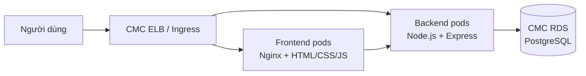

# SportHub — nền tảng booking sân thể thao

## Kiến trúc



- Frontend và backend chạy thành Deployment riêng, mỗi bên mặc định 2 replica.
- Ingress route `/` tới frontend, `/api` và `/health` tới backend.
- PostgreSQL nằm ngoài cluster trong DB isolated subnet; không có DB pod ở production.
- Migration chạy trong init container, có PostgreSQL advisory lock để an toàn khi nhiều pod khởi động đồng thời.
- HPA, PDB, health probes, non-root container, resource limits và NetworkPolicy đã được khai báo.
- PostgreSQL dùng exclusion constraint để chặn hai booking hoạt động trùng thời gian ngay cả khi có request đồng thời.

## Cấu trúc thư mục

```text
backend/               Express API, migration, seed, tests
frontend/              HTML/CSS/JavaScript thuần + Nginx
k8s/base/              Manifest dùng chung
k8s/overlays/lab/      Overlay image registry/domain
docker-compose.yml     Môi trường local có PostgreSQL
```

Các tài khoản seed:
| Vai trò | Email | Mật khẩu |
|---|---|---|
| Người thuê | `renter@sporthub.vn` | `SportHub@123` |
| Chủ sân | `owner@sporthub.vn` | `SportHub@123` |
| Quản trị | `admin@sporthub.vn` | `SportHub@123` |

Các tài khoản này chỉ phục vụ demo; không chạy seed job hoặc phải đổi/xóa tài khoản trước khi dùng production.

## API chính

| Nhóm | Endpoint |
|---|---|
| Xác thực | `POST /api/auth/register`, `POST /api/auth/login`, `GET /api/auth/me` |
| Tra cứu | `GET /api/venues/courts`, `GET /api/venues/courts/:id/quote`, `GET /api/venues`, `GET /api/venues/:id`, `GET /api/venues/:id/availability` |
| Người thuê | `POST /api/bookings`, `GET /api/bookings/my`, `PATCH /api/bookings/:id/cancel` |
| Chủ sân | `/api/owner/venues`, `/api/owner/bookings`, `/api/owner/revenue` |
| Quản trị | `/api/admin/stats`, `/api/admin/users`, `/api/admin/venues` |

## Triển khai lên CMC Cloud

### 1. Chuẩn bị hạ tầng

1. Tạo VPC và các subnet theo sơ đồ: application subnet cho worker node, isolated/private subnet cho RDS, management subnet cho bastion nếu cần.
2. Tạo CMC Kubernetes cluster trong cùng VPC; production nên chọn 3 master và ít nhất 2 worker phân bố hợp lý giữa AZ.
3. Tạo CMC RDS for PostgreSQL, database `sporthub` và user ứng dụng riêng.
4. Security Group của RDS chỉ cho phép TCP cổng PostgreSQL từ CIDR node/pod của cluster. Không mở RDS ra Internet.

Migration cần quyền `CREATE EXTENSION` cho `pgcrypto` và `btree_gist`. Có thể chạy bằng tài khoản admin lần đầu, sau đó chuyển `DATABASE_URL` sang user ứng dụng chỉ có quyền trên schema/tables.

### 2. Cấu hình Kubernetes

Tùy chỉnh trong /k8s/overlays/lab/kustomization.yaml sau đó tạo các secret tương ứng.

```bash
kubectl apply -f k8s/base/namespace.yaml

kubectl -n sporthub create secret generic sporthub-secrets \
  --from-literal=DATABASE_URL='postgresql://sporthub:<PASSWORD>@<RDS_PRIVATE_IP>:5432/sporthub' \
  --from-literal=JWT_SECRET="$(openssl rand -base64 48)" \
  --from-literal=REDIS_URL=''

kubectl -n sporthub create secret generic sporthub-s3 \
  --from-literal=S3_ACCESS_KEY_ID='<S3_ACCESS_KEY>' \
  --from-literal=S3_BUCKET='<BUCKET_NAME>' \
  --from-literal=S3_ENDPOINT='<S3_ENDPOINT>' \
  --from-literal=S3_REGION='<S3_REGION>' \
  --from-literal=S3_SECRET_ACCESS_KEY='<S3_SECRET_ACCESS_KEY>'
```

### 3. Apply và kiểm tra

Cluster cần có NGINX Ingress Controller và Metrics Server trước khi HPA hoạt động.

```bash
kubectl apply -k k8s/overlays/lab
kubectl -n sporthub rollout status deployment/backend
kubectl -n sporthub rollout status deployment/frontend
kubectl -n sporthub get pods,svc,ingress,hpa
kubectl -n sporthub logs deployment/backend --tail=100
```

Để nạp dữ liệu demo (không dùng cho production), chỉnh image trong `seed-job.example.yaml` rồi chạy:

```bash
kubectl apply -f k8s/base/seed-job.example.yaml
kubectl -n sporthub logs job/sporthub-seed
```

Trỏ DNS domain vào public IP của CMC ELB/Ingress. Nếu ingress controller được cài ở namespace khác `ingress-nginx`, sửa `namespaceSelector` trong `network-policy.yaml` cho đúng label namespace thực tế.

## Biến môi trường backend

| Tên | Bắt buộc | Mô tả |
|---|---:|---|
| `DATABASE_URL` | Có | PostgreSQL connection string của CMC RDS |
| `JWT_SECRET` | Có | Chuỗi ngẫu nhiên tối thiểu 32 ký tự |
| `DATABASE_SSL` | Tùy RDS | `true` nếu endpoint bắt buộc SSL |
| `CORS_ORIGIN` | Có | Domain frontend; hỗ trợ nhiều domain phân cách bởi dấu phẩy |
| `DB_POOL_MAX` | Không | Số connection tối đa mỗi backend pod, mặc định 10 |
| `REDIS_URL` | Không | Dự phòng để tích hợp cache/rate-limit phân tán |

Lưu ý tổng connection pool: `số backend pod × DB_POOL_MAX` phải nhỏ hơn giới hạn kết nối RDS, có khoảng trống cho migration và tác vụ quản trị.

## Kiểm thử

```bash
cd backend
npm ci
npm test
```
